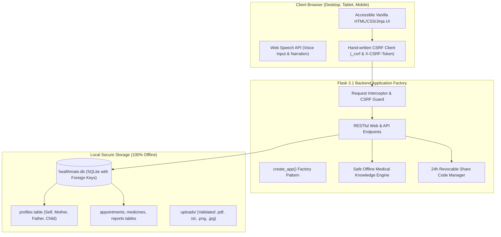

# 🏆 HealthMate AI — Complete Hackathon Presentation Pack & Mentor Guide

**Project Goal:** Multilingual, offline-first personal health copilot designed for Indian families and rural/low-income users. Keeps hospital papers safe and organized, explains confusing lab terms in plain Telugu & English, finds nearby low-cost care with transparent pricing, and prepares a 1-page appointment summary pack.

---

## ⏱️ 1-Minute Elevator Pitch

> *"In India, over 800 million citizens carry their entire medical history inside wrinkled paper envelopes. When visiting public hospitals or community clinics, elderly patients and rural families often forget past test values, cannot decipher technical lab jargon, and face long queues without knowing low-cost alternatives.*
>
> *HealthMate AI is an offline-first personal copilot built specifically for them: it organizes physical paper slips into a unified family timeline, translates lab results into plain Telugu and English voice narration, generates a 1-page Appointment Preparation Pack for the doctor visit, and guides users to nearby free Primary Health Centres and Aarogyasri-empanelled hospitals.*
>
> *With zero cloud tracking, hand-written CSRF security, and guaranteed offline SQLite reliability, HealthMate AI delivers healthcare dignity to every household."*

---

## 🎯 The 5 Strong Hackathon Focus Areas (With Evidence in Code)

| Focus Area | Hackathon Problem Solved | Real File Implementation | Test Coverage |
| :--- | :--- | :--- | :--- |
| **1. Papers Kept Organised** | Physical hospital slips and lab results get lost across months of clinic visits. | [templates/timeline.html](file:///c:/healthMateAI/templates/timeline.html)<br>[app.py](file:///c:/healthMateAI/app.py#L1310-L1410) (`/timeline`, `/api/timeline`) | `test_step2_timeline_profiles.py` |
| **2. Appointment Prep Pack** | Doctors in Indian clinics have under 3 minutes; patients forget crucial symptoms and questions. | [templates/prep.html](file:///c:/healthMateAI/templates/prep.html)<br>[app.py](file:///c:/healthMateAI/app.py#L1350-L1380) (`/prep`, `/api/prep-pack`) | `test_stage1.py` |
| **3. Low-Cost Care & Schemes** | Commercial apps promote ₹1,000+ metro clinics, ignoring free PHCs and state insurance. | [templates/find_care.html](file:///c:/healthMateAI/templates/find_care.html)<br>[care_data.py](file:///c:/healthMateAI/care_data.py) (`/find-care`, `/api/care`) | `test_stages2_to_6.py` |
| **4. Multilingual & Voice** | Rural and elderly users struggle with English interfaces and small screen fonts. | [translations.json](file:///c:/healthMateAI/translations.json)<br>[static/script.js](file:///c:/healthMateAI/static/script.js) (Web Speech API) | `test_stages2_to_6.py` |
| **5. Family Profiles** | Entire joint families share a single smartphone; Grandma's BP slips must not mix with child's papers. | [templates/timeline.html](file:///c:/healthMateAI/templates/timeline.html)<br>[app.py](file:///c:/healthMateAI/app.py#L1250-L1310) (`/api/profiles`) | `test_step2_timeline_profiles.py` |

---

## 🎬 3-Minute Live Hackathon Demo Script

```text
[0:00 - 0:45] The Problem & The Family Timeline:
• Open Dashboard (http://127.0.0.1:5000)
• Show the Family Profile Switcher bar (Grandpa Rao, 72M, O+).
• Click "📁 Records Timeline".
• Speak: "In India, hospital papers are carried in plastic covers and frequently lost. 
  HealthMate AI organizes doctor visits, lab reports, and prescriptions onto a single 
  date spine. One click switches to daughter Ananya's records on the same phone."

[0:45 - 1:30] Term Explainer & Vernacular Voice Read-Aloud:
• Click "📖 Term Explainer".
• Click quick suggestion "HbA1c".
• Point to the badge "Educational fallback (not AI)".
• Click "🔊 Read Aloud" to hear the slow audio explanation.
• Speak: "Patients are frightened by abnormal numbers. Our offline glossary provides 
  standard ranges, healthy diet advice, and Telugu translations without dangerous 
  AI hallucinations."

[1:30 - 2:15] Finding Nearby Low-Cost Care & Government Schemes:
• Click "🏥 Find Care".
• Filter by "Dentist" and select "Female Doctor Available".
• Point out the Government Scheme cards (Aarogyasri & Ayushman Bharat PM-JAY).
• Speak: "Unlike Practo which pushes ₹1,500 private hospitals, HealthMate AI features 
  free Primary Health Centres, charitable clinics, and state insurance schemes."

[2:15 - 2:45] Appointment Preparation Pack & Doctor Share Portal:
• Click "📋 Prep Pack", fill symptom, and click "Generate Pack".
• Show printable 1-page summary.
• Open "👨‍⚕️ Doctor View", generate temporary code "HM-4821".
• Speak: "During a 3-minute clinic visit, doctors get an instant summary of medications 
  and symptoms without the patient giving up their personal account password."

[2:45 - 3:00] Safety Guardrails & Conclusion:
• Highlight the persistent 112/108/104 Red Emergency Banner.
• Speak: "HealthMate AI never prescribes medicines independently, warns immediately 
  on acute emergencies, and keeps 100% of data private on local SQLite. Thank you!"
```

---

## 🏗️ System Architecture Diagram



---

## 📊 Competitor Comparison Matrix

| Feature | HealthMate AI | Apple Health | Epic MyChart | Ada Health | eSanjeevani | Practo | ABHA / ABDM | Apollo 24/7 | Tata 1mg |
| :--- | :---: | :---: | :---: | :---: | :---: | :---: | :---: | :---: | :---: |
| **100% Offline SQLite** | ✅ | ⚠️ (iOS only) | ❌ | ❌ | ❌ | ❌ | ❌ | ❌ | ❌ |
| **Telugu / Hindi / Tamil Voice**| ✅ | ❌ | ❌ | ❌ | ✅ | ❌ | ⚠️ | ❌ | ⚠️ |
| **Physical Paper Timeline** | ✅ | ❌ | ❌ | ❌ | ❌ | ⚠️ | ⚠️ | ⚠️ | ❌ |
| **Low-Cost Government Schemes**| ✅ | ❌ | ❌ | ❌ | ⚠️ | ❌ | ⚠️ | ❌ | ❌ |
| **Single-Device Family Profiles**| ✅ | ❌ | ⚠️ | ⚠️ | ❌ | ⚠️ | ❌ | ⚠️ | ⚠️ |
| **Free Open-Source (Zero Ads)**| ✅ | ❌ | ❌ | ❌ | ✅ | ❌ | ✅ | ❌ | ❌ |

---

## ❓ Judge Q&A Cheat Sheet

### Q1: "Why not simply use ChatGPT or WhatsApp for health advice?"
> **Answer:** *"ChatGPT frequently hallucinates drug doses, requires continuous internet, uploads confidential health prompts to commercial clouds, and cannot organize physical hospital slips into a date timeline or generate a printable clinic prep pack. HealthMate AI is an offline-first system with strict medical guardrails, local SQLite privacy, and verified Indian public health registries."*

### Q2: "What if a user enters an acute emergency symptom like chest pain or stroke?"
> **Answer:** *"Safety is our top priority. Our emergency guardrail engine intercepts emergency keywords (chest pain, stroke, breathlessness) and immediately flashes an emergency alert to call 108 (Ambulance) or 112 (National Helpline), refusing to formulate conversational replies during life-threatening crises."*

### Q3: "How does this integrate with the Government of India's ABHA / ABDM ecosystem?"
> **Answer:** *"ABDM is an infrastructure standard, but it lacks a simple bilingual Telugu explainer for rural citizens. HealthMate AI acts as the citizen-facing bridge: it can link with the 14-digit ABHA number and pull clinic coordinates directly from the National Digital Health Mission Health Facility Registry API (data.gov.in) with zero API licensing cost."*

### Q4: "Why use hand-written CSRF instead of an external package?"
> **Answer:** *"To ensure zero-dependency reliability and uniform security across both standard HTML form submissions (`_csrf`) and asynchronous fetch headers (`X-CSRF-Token`), while avoiding package bloat on Windows student environments."*

---

## 💻 Evaluator Startup & Testing Commands

### 1. Run the Full Automated Test Suite (All 42 Tests):
```powershell
python -m unittest discover -s tests -v
```

### 2. Run HealthMate AI Locally:
```powershell
python app.py
```

### 3. Open in Browser:
```text
http://127.0.0.1:5000
```
